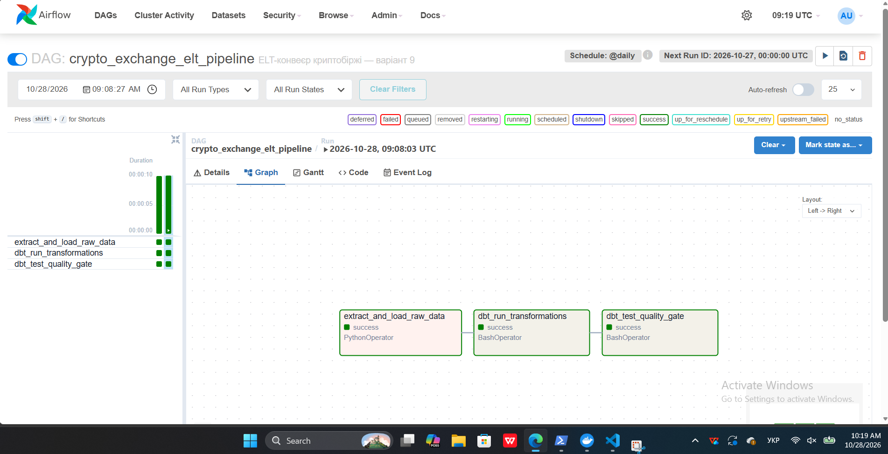

# Лабораторна робота №3

## Оркестрація та Data Quality Gates

Дисципліна: «Технології сховищ даних».

Варіант №9 — Криптобіржа.

Кластер 2: Finance & Services — Фінанси та Послуги.

## Мета роботи

Створити автоматизований ELT-конвеєр за допомогою Apache Airflow,
об’єднати завантаження даних із dbt-трансформаціями та налаштувати
перевірки якості після трансформацій.

Проєкт містить власний генератор і dbt-моделі для самостійного
відтворення лабораторної роботи №3.

## Використані технології

- Windows 11 та Ubuntu у WSL 2.
- Python 3.11.
- Docker Desktop і Docker Compose.
- PostgreSQL 15.
- Apache Airflow 2.10.5.
- dbt-core 1.9.4.
- dbt-postgres 1.9.0.

## Дані криптобіржі

Генератор створює штучний навчальний набір даних.

| Таблиця у схемі raw | Призначення | Кількість записів |
|---|---|---:|
| traders | Трейдери | 100 |
| currencies | Криптовалюти | 5 |
| wallets | Гаманці | 500 |
| trades | Угоди | 2000 |
| deposits_withdrawals | Введення та виведення коштів | 1000 |

Під час повторного завантаження попередній навчальний набір
у цих п’яти таблицях замінюється новим в одній транзакції.

Ціни є навчальними, а не поточними ринковими курсами.

## Структура проєкту

- `airflow/dags/crypto_exchange_pipeline.py` — Airflow DAG.
- `airflow/dags/scripts/data_generator.py` — генерація та завантаження.
- `crypto_dbt/dbt_project.yml` — налаштування dbt-проєкту.
- `crypto_dbt/profiles.yml` — підключення через змінні середовища.
- `crypto_dbt/models/staging/` — п’ять staging-моделей і тести.
- `crypto_dbt/models/marts/` — три виміри та дві таблиці фактів.
- `docker-compose.yml` — конфігурація PostgreSQL.
- `requirements.txt` — залежності Airflow.
- `requirements-dbt.txt` — залежності dbt.
- `images/airflow_graph_success.png` — скріншот виконання.

## Трансформації dbt

У схемі analytics створюються п’ять staging-представлень:

- stg_traders;
- stg_currencies;
- stg_wallets;
- stg_trades;
- stg_deposits_withdrawals.

Аналітичний шар містить:

- dim_traders;
- dim_currencies;
- dim_wallets;
- fct_trades;
- fct_deposits_withdrawals.

У fct_trades обчислюється total_usd = quantity * price_usd.

У fct_deposits_withdrawals поле signed_amount має додатний знак
для введення та від’ємний для виведення. Кількості різних
криптовалют аналізуються окремо за currency_id.

## Перевірки якості

У models/staging/schema.yml налаштовано по дві перевірки
ідентифікаторів для кожної з п’яти staging-моделей:

- unique — відсутність дублікатів;
- not_null — відсутність NULL.

Обов’язкові перевірки з методички адаптовано до
stg_traders.trader_id відповідно до варіанта №9.

Результат виконання dbt test:

```text
PASS=10 WARN=0 ERROR=0 SKIP=0 TOTAL=10
```

## Airflow DAG

Назва DAG: crypto_exchange_elt_pipeline.

Послідовність завдань:

```text
extract_and_load_raw_data
          ↓
dbt_run_transformations
          ↓
dbt_test_quality_gate
```

Перше завдання використовує PythonOperator і викликає
load_data_to_dwh().

Друге завдання використовує BashOperator і виконує dbt run.

Третє завдання використовує BashOperator і виконує dbt test.
Помилка тестів спричиняє помилку завдання та непройдений Quality Gate.

Налаштування:

- розклад — @daily, часовий пояс UTC;
- catchup — False;
- одна повторна спроба після помилки;
- затримка перед повторною спробою — 5 хвилин;
- максимум один активний запуск DAG.

## Запуск налаштованого проєкту

Команди виконуються в Ubuntu з кореневої папки проєкту.
Потрібні встановлені залежності в .venv-airflow та .venv-dbt
і локальний файл .env із налаштуваннями бази.

```bash
source .venv-airflow/bin/activate

set -a
source .env
set +a

export AIRFLOW_HOME="$PWD/airflow"
export AIRFLOW__CORE__DAGS_FOLDER="$AIRFLOW_HOME/dags"
export AIRFLOW__CORE__LOAD_EXAMPLES=False

docker compose up -d --wait

airflow standalone
```

Вебінтерфейс: http://localhost:8080.

Увімкнути crypto_exchange_elt_pipeline, натиснути Trigger DAG
і перевірити результати на вкладці Graph.

Для окремого запуску трансформацій і тестів:

```bash
.venv-dbt/bin/dbt run --project-dir crypto_dbt --profiles-dir crypto_dbt

.venv-dbt/bin/dbt test --project-dir crypto_dbt --profiles-dir crypto_dbt
```

## Результат виконання

Усі три завдання Airflow завершилися зі статусом success.



## Висновок

Створено автоматизований ELT-конвеєр криптобіржі.
Airflow забезпечує послідовне завантаження даних,
виконання dbt-трансформацій і перевірку якості.
У PostgreSQL створено сирий та аналітичний шари даних.
Усі десять dbt-тестів пройдено успішно.